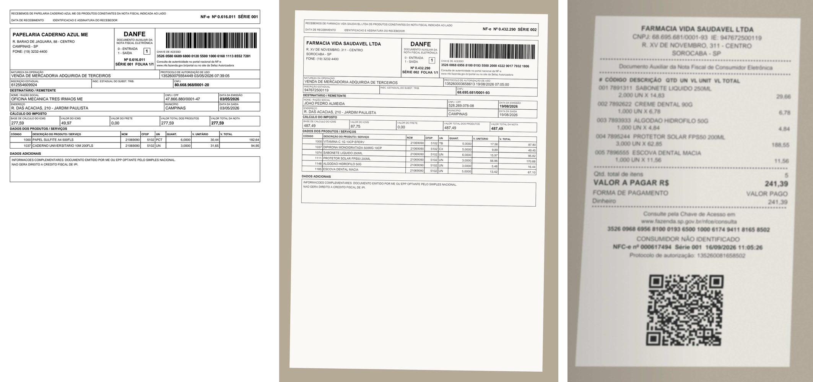
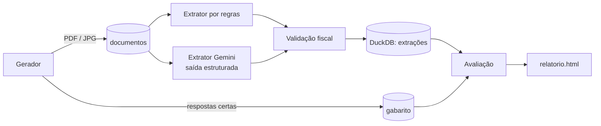

# Notas fiscais com IA · extração medida contra um gabarito

Extrai os dados de notas fiscais brasileiras (DANFE de NF-e e cupom de NFC-e) com o Gemini,
em PDF ou foto, e **mede quanto ele acerta**, campo a campo, contra um gabarito. A mesma
avaliação roda numa linha de base sem IA, para mostrar o que o modelo acrescenta e onde ele
ainda erra. Uma camada de validação fiscal, que não depende do modelo, decide quais notas
precisam de revisão humana.


<sub>Notas sintéticas geradas pelo projeto: PDF digital, foto boa e foto ruim.</sub>

## Por que um gabarito sintético

Para medir um extrator é preciso saber a resposta certa de cada campo, e notas reais têm
dados pessoais e fiscais. O projeto gera as suas: empresas e pessoas fictícias, mas com o
leiaute dos documentos reais, código de barras e QR code, valores que fecham e **CNPJ, CPF e
chave de acesso com dígitos verificadores válidos**. Cada nota sai em uma de três versões:

| Versão | Como é |
| --- | --- |
| PDF digital | texto selecionável, o caso fácil |
| Foto boa | bem enquadrada, leve inclinação e compressão |
| Foto ruim | inclinada, em perspectiva, desfocada, com sombra e ruído, como uma foto de celular apressada |

## Como funciona



- **Extrator Gemini** (`notas/extratores/gemini.py`): envia o arquivo e pede a nota em JSON com
  o esquema do próprio modelo Pydantic (`response_json_schema`), temperatura zero. Erros
  temporários (limite de requisições, servidor ocupado) são repetidos com espera crescente.
- **Linha de base por regras** (`notas/extratores/regras.py`): lê o texto do PDF e aplica
  expressões regulares feitas para esse leiaute. É o melhor caso de uma solução sem IA, e
  não lê imagem nenhuma.
- **Validação fiscal** (`notas/validacao.py`): dígitos verificadores do CNPJ, do CPF e da chave;
  coerência da chave de 44 dígitos com o CNPJ, o modelo, a série, o número e o mês da nota;
  itens que somam o total. Não usa o gabarito: é o que daria para rodar em produção.
- **Lote com cache** (`notas/lote.py`): cada documento é extraído uma vez por versão do prompt
  e do modelo. Rodar de novo retoma de onde parou, e um erro numa nota não para as outras.
- **Avaliação** (`notas/avaliacao.py`): compara campo a campo e mede também a validação: quantas
  notas com erro ela sinaliza e quantas notas certas ela sinaliza à toa.

## O que é medido

- **Notas 100% certas:** todos os campos e todos os itens bateram.
- **Acerto por campo:** chave, número, série, data, emitente, CNPJ, destinatário, total e itens.
  Textos são comparados sem acento e sem diferença de maiúsculas, valores com tolerância de
  1 centavo, e os itens precisam bater todos, na ordem.
- **Notas não lidas:** extração vazia conta como erro em todos os campos, inclusive nos que
  deveriam mesmo ficar vazios.
- **A validação pega os erros?** Erros sinalizados e alarmes falsos.
- **Custo:** tokens de entrada e saída por nota, e o valor em dólares se você informar o preço.

## Como rodar

Precisa de Python 3.11+.

```bash
git clone https://github.com/BrunoSakamoto/notas-fiscais-ia
cd notas-fiscais-ia
python -m venv .venv && source .venv/bin/activate   # Windows: .venv\Scripts\activate
pip install -e ".[dev]"

python -m notas gerar --quantidade 60   # notas sintéticas + gabarito em dados/
python -m notas extrair regras          # linha de base, sem IA
python -m notas avaliar                 # dados/relatorio.html
```

**Com o Gemini:** crie uma chave gratuita em [Google AI Studio](https://aistudio.google.com),
copie `.env.example` para `.env` e preencha `GEMINI_API_KEY`. Depois:

```bash
python -m notas extrair gemini   # opcional: --modelo outro-modelo  --paralelo 2
python -m notas avaliar
```

Rodar `extrair gemini` de novo não gasta cota: só o que faltou é enviado. O plano gratuito
tem limite de requisições por minuto e por dia. No limite por minuto, o extrator espera o
tempo que a API pede e continua; quando a cota do dia acaba, o lote para na hora, avisa, e
basta rodar de novo no dia seguinte para completar. Trocar o prompt
exige mudar `VERSAO` em `gemini.py`, e trocar o modelo cria uma série de resultados separada,
o que permite comparar modelos lado a lado no mesmo relatório.

## Testes

```bash
pytest -v
```

31 testes: dígitos verificadores (inclusive o CNPJ alfanumérico que passa a valer em 2026),
gerador (toda nota do gabarito passa na própria validação), regras, validação, cache e
retomada do lote, métricas e o extrator Gemini com um cliente falso, que confere o pedido
enviado e o tratamento de erros (inclusive cota do dia esgotada) sem gastar cota. O GitHub Actions roda os testes e o fluxo
completo com a linha de base a cada push.

## Estrutura

```
notas/
  documentos.py   CNPJ, CPF e chave de acesso
  modelo.py       a nota: gabarito, resposta dos extratores e esquema do Gemini
  gerador.py      notas sintéticas (DANFE, NFC-e, fotos) e gabarito
  extratores/     regras e Gemini
  validacao.py    regras fiscais, sem gabarito
  lote.py         execução em lote com cache no DuckDB
  avaliacao.py    comparação com o gabarito e resumos em SQL
  relatorio.py    relatório HTML
tests/
```

---

Feito por [Bruno Araújo Sakamoto](https://www.linkedin.com/in/bruno-a-sakamoto/).
